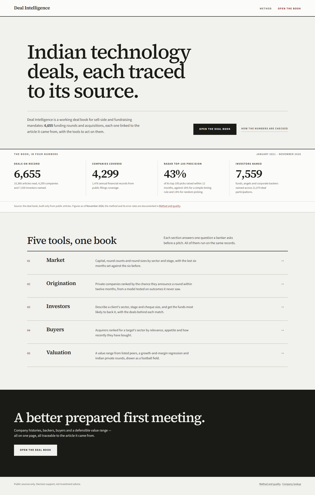
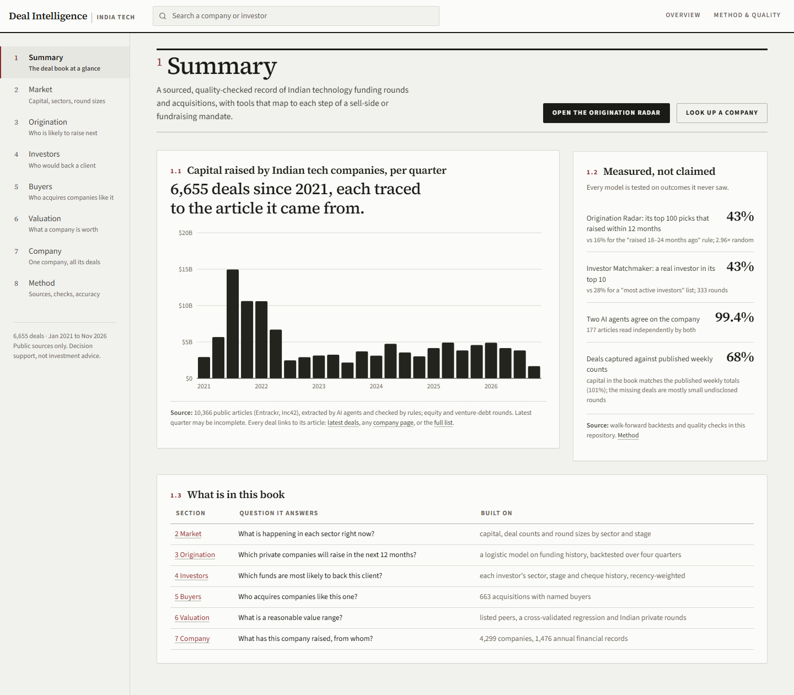
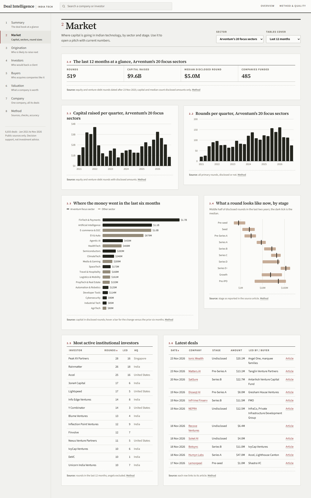
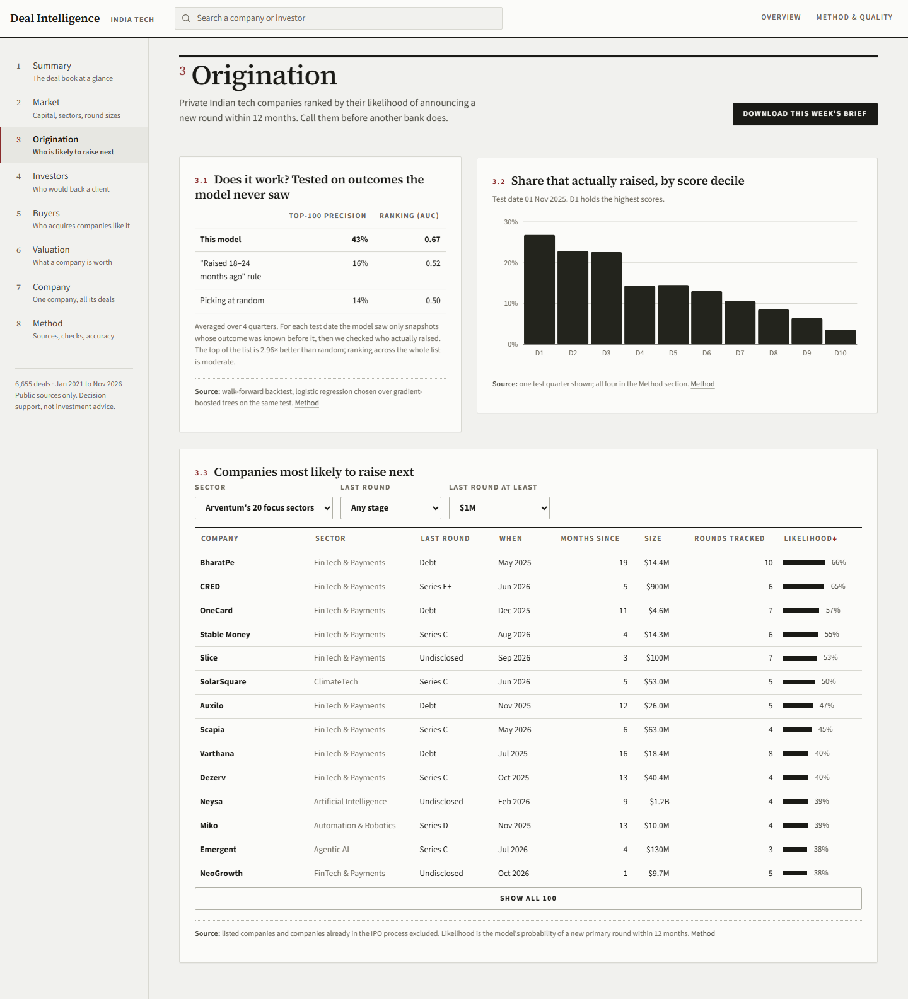
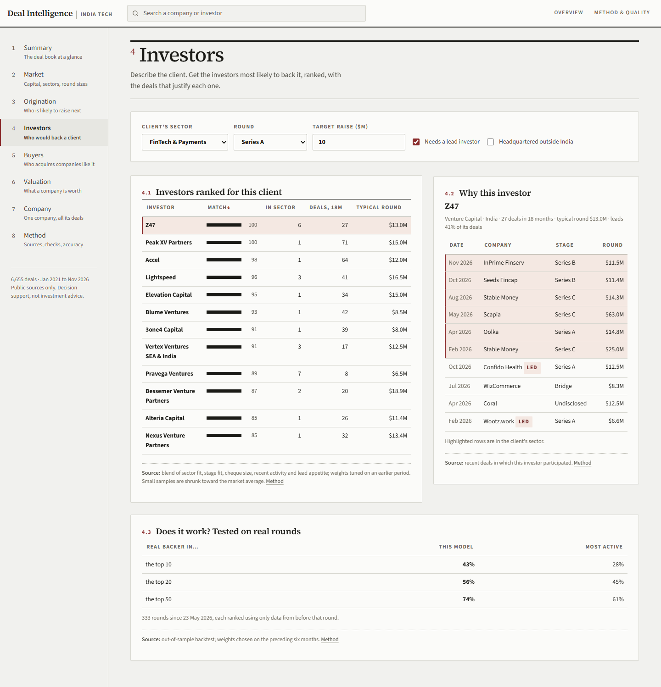
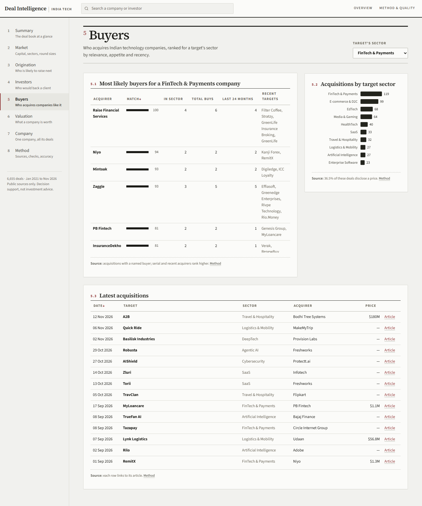
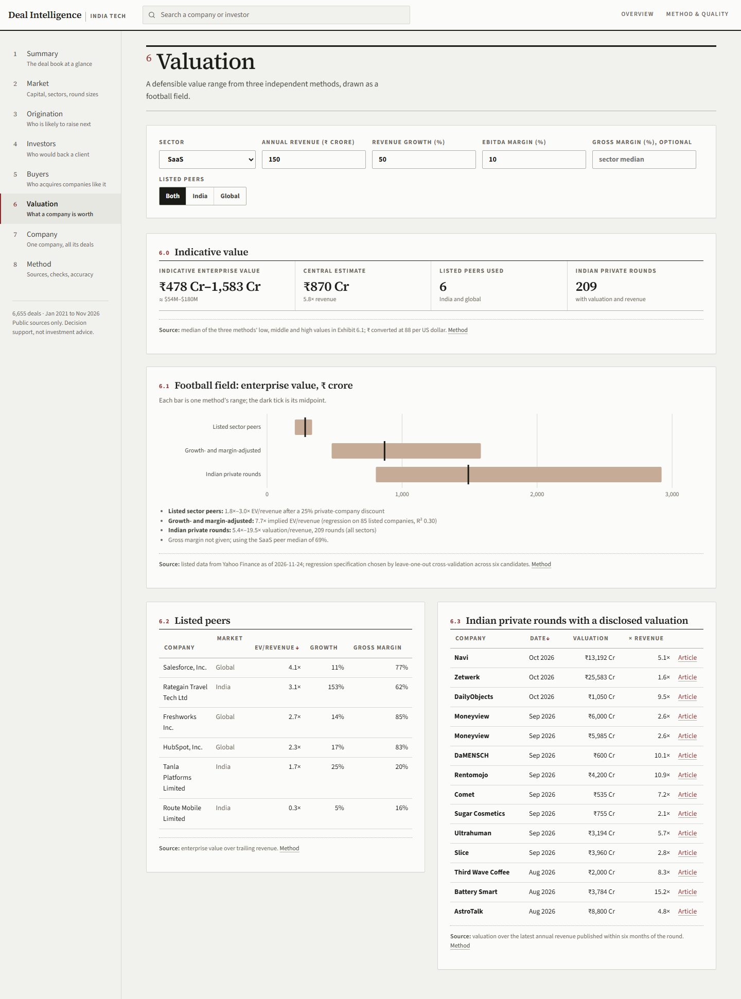
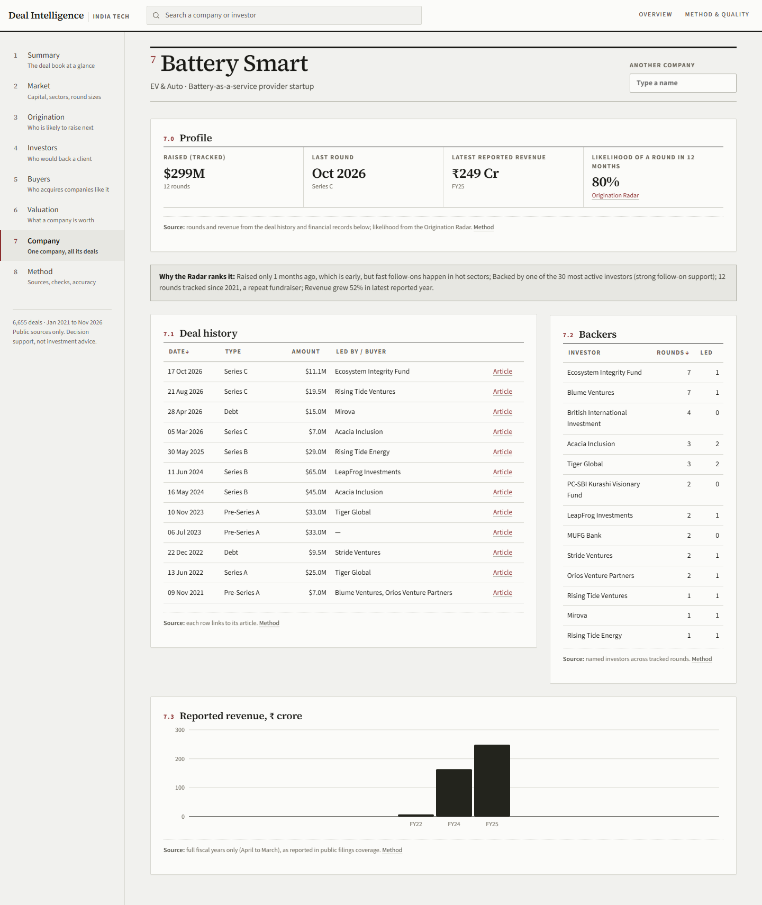
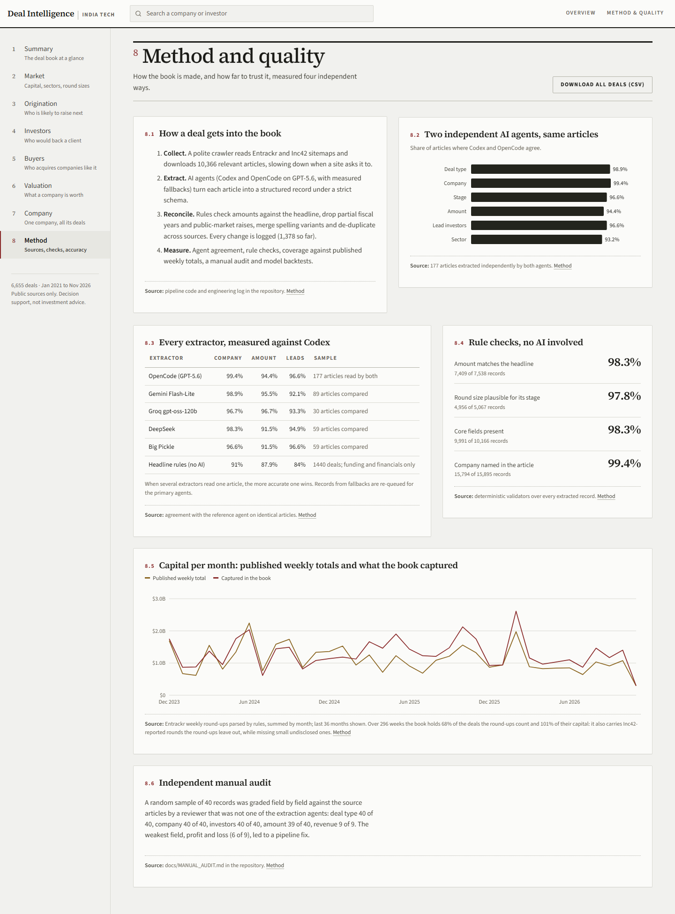

# Deal Intelligence: Indian technology deals, sourced and measured

**Live website: https://deal-intelligence-kappa.vercel.app**

A free, working deal book for a technology investment bank. It records **6,655 Indian technology deals since January 2021**, each linked to the news article it came from. On top of that record sit five tools that help with a sell-side or fundraising mandate: who to call, who would invest, who would buy, and what a company is worth. Every prediction tool has been **tested on past outcomes it never saw**, so its accuracy is measured rather than claimed.

Built for Arventum Global Capital as an internship project, using only public data, at zero cost.



---

## Contents
1. [What the website does, section by section](#1-what-the-website-does-section-by-section)
2. [The numbers at a glance](#2-the-numbers-at-a-glance)
3. [How the data was built](#3-how-the-data-was-built)
4. [How we know it is right](#4-how-we-know-it-is-right)
5. [What it cannot do (limitations)](#5-what-it-cannot-do-limitations)
6. [How it was built, and what it cost](#6-how-it-was-built-and-what-it-cost)
7. [What could come next](#7-what-could-come-next)
8. [Glossary](#8-glossary)
9. [For developers](#9-for-developers)

---

## 1. What the website does, section by section

The front page introduces the project. **Open the deal book** leads to the tool, which has eight numbered sections in the left menu. Every chart and table is a numbered "exhibit" with a **Source:** line underneath. Deal rows link to the original article. The search box at the top finds any company or investor.

| # | Section | The question it answers | How to use it | Proof it works |
|---|---|---|---|---|
| 1 | **Summary** | What is in this book, and can I trust it? | Read the capital-per-quarter chart and the "Measured, not claimed" results. | Backtest results shown on the page |
| 2 | **Market** | What is happening in each sector right now? | Pick a sector (or Arventum's 20 focus sectors) and a period. See capital raised, deal counts, where money went in the last six months, typical round sizes by stage, the most active investors and the latest deals. | Organised facts, every deal linked to its article |
| 3 | **Origination** (the Radar) | Which private companies are likely to raise money in the next 12 months? | Filter by sector, stage and size. Click a company to see why it scores high. **Download this week's brief** saves a "top 10 to call" note. | Its top 100 picks raised within a year **43%** of the time, against **16%** for the usual "raised 18–24 months ago" rule and 14% for random picks |
| 4 | **Investors** (the Matchmaker) | Which funds are most likely to back this client? | Enter the client's sector, round, target raise, and whether it needs a lead investor (optionally, only investors based outside India). Click an investor to see the deals that justify the match. | On 333 real rounds, a real investor was in its top 10 **43%** of the time, against **28%** for a plain "most active investors" list |
| 5 | **Buyers** | Who acquires companies like this one? | Pick the target's sector. Acquirers are ranked by how many similar companies they have bought, how many in total, and how recently. | Built from 663 acquisitions |
| 6 | **Valuation** (the Price Finder) | What is a reasonable value range? | Enter revenue (₹ crore), growth, EBITDA margin and optionally gross margin. Get a range from three independent methods, drawn as a football-field chart. | The method was chosen by testing six candidate formulas on companies held out of the fit |
| 7 | **Company** | What has this company raised, and from whom? | Search any company. See its full deal history, backers, reported revenue and its Radar score. | Every row links to its article |
| 8 | **Method** | How was this made, and how accurate is it? | Read the four quality checks and download every deal as a spreadsheet (CSV). | Agent agreement, rule checks, coverage, manual audit |

<details>
<summary>Screenshots of each section</summary>

**Summary** 
**Market** 
**Origination** 
**Investors** 
**Buyers** 
**Valuation** 
**Company** 
**Method** 

</details>

### How the tools work, in plain words

- **Origination Radar.** A statistical model (logistic regression) looks at each private company's funding history: months since its last round, the size of that round, how many rounds it has raised, its stage, whether a top-30 investor backs it, and how busy its sector is. From those it estimates the chance of a new round within 12 months. Listed companies, and companies already in the IPO process, are excluded. A more complex model (gradient-boosted trees) was also tried and did no better, so the simpler one was kept.
- **Investor Matchmaker.** Each investor is scored on five things, weighted by how much each predicted real deals:
  - recent activity: 45%
  - sector fit: 15%
  - stage fit: 15%
  - cheque-size fit: 15%
  - appetite for leading rounds: 5%

  An investor with only a couple of deals is pulled toward the market average, so a tiny track record cannot fool the score. The weights were chosen on one six-month period and tested on a later one.
- **Buyer Mapping.** Acquirers are ranked by relevance (how many companies in the target's sector they bought), appetite (total acquisitions) and recency (buys in the last 24 months). Each buyer and target pair is counted once, even when the announcement and the completion were reported separately.
- **Price Finder.** Three independent methods are drawn side by side:
  1. **Listed peers:** the middle range of enterprise value to revenue for listed companies in the same sector (87 listed companies from Yahoo Finance), with a 25% discount because private shares are harder to sell.
  2. **Growth and margin regression:** a formula fitted on 85 listed companies that adjusts the multiple for growth, EBITDA margin, gross margin and India versus global listing. It explains about 30% of the variation in multiples (R² 0.30), so it is a guide rather than an answer.
  3. **Indian private rounds:** real funding rounds where both the valuation and the revenue were reported (131 rounds).

  The final range is the middle of the three.

---

## 2. The numbers at a glance

| | |
|---|---|
| Deals | **6,655** (January 2021 to 23 November 2026) |
| Companies | **4,299** |
| Investors | **7,559** |
| Investor participations in deals | **21,079** (one deal usually has several investors) |
| Acquisitions | **663** |
| Company revenue and profit records | **1,476** full fiscal years |
| News articles used | **10,366** (Entrackr and Inc42) |
| Automatic corrections, each logged | **1,378** |
| Cost | **₹0** |

The 6,655 deals break down as:

| Type | Count | Meaning |
|---|---|---|
| Equity | 5,215 | A startup sells shares to investors: a normal funding round |
| Acquisition | 663 | One company buys another |
| Debt | 278 | A startup borrows money |
| Secondary | 252 | Existing shareholders sell shares; the company gets no new money |
| IPO | 148 | IPO milestones, each labelled by step: papers filed, SEBI approval, issue opens, listed |
| Public market | 99 | Listed companies raising money (for example QIPs), and corporate deals such as Foxconn |

Startup statistics (capital raised, round sizes) use only **equity and debt** rounds, because only those put new money into a startup.

---

## 3. How the data was built

1. **Collect.** A program read the published lists of every article on Entrackr and Inc42, two Indian startup news sites, and downloaded the relevant ones. These were funding news, acquisition news and revenue/profit news. It slows down automatically when a site is busy.
2. **Extract.** AI agents read each article and filled in a strict form: company, amount, date, stage, lead and other investors, buyer, sector, revenue and profit.
   - The main readers were **Codex** and **OpenCode**, both running GPT-5.6 on a ChatGPT subscription.
   - When that subscription's usage limit ran out, free models (Google Gemini, Groq, DeepSeek and others) took over. Each was measured against Codex first, and their articles were sent back to the main readers when possible.
3. **Clean.** Rules check and repair the AI's output. Every change is recorded (1,378 in total). The main rules:
   - Use the amount in the headline when the AI's amount matches none of the headline's amounts (121 fixes).
   - Recognise one company or investor under different spellings, for example "Sequoia India" and "Peak XV Partners", or "Agnikul" and "Agnikul Cosmos" (77 company name variants merged).
   - Merge the same deal reported by both sites into one record.
   - Drop half-year revenue figures that would look like a full year (851).
   - Move listed-company raises and corporate deals out of the startup figures (118).
   - Drop records from before 2021, records that pack several companies together, and other impossible records.
4. **Check.** Four independent quality checks run on every rebuild (next section).
5. **Publish.** The database is exported to small data files that the website reads. The site has no server and no passwords, which is why it is free to host.

The whole rebuild (steps 3 to 5) is one command. See [For developers](#9-for-developers).

---

## 4. How we know it is right

1. **Two AIs, same articles.** 177 articles were read separately by Codex and OpenCode. They agree on:

   | Field | Agreement |
   |---|---|
   | Company | 99.4% |
   | Deal type | 98.9% |
   | Stage | 96.6% |
   | Lead investors | 96.6% |
   | Amount | 94.4% |
   | Sector | 93.2% |

2. **Rule checks with no AI involved, on every record:**

   | Check | Pass rate | Records |
   |---|---|---|
   | Amount matches the headline | 98.3% | 7,409 of 7,538 |
   | Round size plausible for its stage | 97.8% | 4,956 of 5,067 |
   | Core fields present | 98.3% | 9,991 of 10,166 |
   | Company named in the article | 99.4% | 15,794 of 15,895 |

3. **Coverage against published totals.** Every week Entrackr publishes "X startups raised $Y". Over 296 weeks the book holds **68%** of the deals those round-ups count, and capital that matches their totals (101%). The missing deals are mostly small rounds with undisclosed amounts. The book also carries Inc42 rounds the round-ups leave out.
4. **Manual audit.** 40 random records were checked field by field against their articles by a reviewer that was not one of the extraction agents:

   | Field | Correct |
   |---|---|
   | Deal type | 40 of 40 |
   | Company | 40 of 40 |
   | Investors | 40 of 40 |
   | Amount | 39 of 40 |
   | Revenue | 9 of 9 |
   | Profit or loss | 6 of 9, the weakest field, which led to a pipeline fix |

**Errors found and fixed: 36, all logged.** Real data is messy, and [`docs/ENGINEERING_LOG.md`](docs/ENGINEERING_LOG.md) lists every problem found, its cause and the fix. Recent examples:
- Corporate deals such as MakeMyTrip's $3.1B financing were counted as startup rounds.
- The same company appeared under two spellings.
- Zepto's IPO *approvals* were shown as a completed IPO.

Each fix is enforced by a check that runs on every rebuild.

---

## 5. What it cannot do (limitations)

- **Public sources only.** About 68% of deals by count are captured. Small, undisclosed rounds are the main gap. A paid database (for example Tracxn or Venture Intelligence) would close it.
- **The Radar ranks the top of its list well, not the whole list.** Its overall ranking score is moderate (AUC 0.67, where 0.5 is random and 1.0 is perfect). Use it to build a call list, not to rule companies out.
- **Valuation is a starting range, not an answer.** The regression explains about 30% of why multiples differ, which is why three methods are shown side by side.
- **Prices of acquisitions are often secret.** Only 36% of acquisitions disclose one.
- **Not investment advice.** It is decision support built from news reports.

---

## 6. How it was built, and what it cost

| Who | Role |
|---|---|
| **The intern** (project owner) | Chose the problem and the tools, set up the accounts and keys, made the design and publishing decisions, and spotted data errors (for example Zepto's IPO status) |
| **Claude Code** (Anthropic) | Architect and lead engineer: designed the system, wrote the pipeline, models and website, coordinated the other AI agents, built the quality checks and fixed the errors they found |
| **Codex and OpenCode** (GPT-5.6) | Read the articles in parallel; a sample was read by both to measure agreement |
| **Gemini, Groq and other free models** | Backup readers when the subscription limit ran out, each measured before use |
| **Freebuff** (Codebuff) | Redesigned the website from a written brief; its work was then reviewed and corrected |
| **Impeccable** (design skill) | Design direction, automated design checks, and an independent design reviewer |
| **GitHub and Vercel** | Version history (this repository) and free hosting |

**Cost: ₹0.** Public data, free hosting, an existing ChatGPT subscription and free AI models.

---

## 7. What could come next

- Add Arventum's CRM and the founders' relationships, so the Matchmaker can prefer warm introductions.
- Add a paid data source to close the coverage gap on small rounds.
- Track which Radar picks turn into mandates, so the model learns from Arventum's own results.
- Refresh weekly and email the "top 10 to call" brief automatically.

---

## 8. Glossary

| Term | Meaning |
|---|---|
| **Deal** | One money event for one company: a funding round, an acquisition, a debt raise, a share sale or an IPO step |
| **Equity round** | A company sells new shares to investors for cash |
| **Lead investor** | The investor who puts in the most and usually sets the terms |
| **Secondary** | Existing shareholders sell their shares; the company receives nothing |
| **IPO, DRHP, SEBI approval** | Listing on the stock exchange. The company first files a draft prospectus (DRHP), then needs approval from SEBI, India's market regulator, before the issue opens and the shares list |
| **QIP** | A listed company sells new shares to large institutions |
| **Fiscal year (FY)** | India's accounting year, 1 April to 31 March. FY25 ends March 2025 |
| **EV (enterprise value)** | What the whole business is worth |
| **EV/revenue multiple** | Enterprise value divided by annual revenue. "5×" means worth five times its yearly sales |
| **EBITDA margin** | Operating profit as a share of revenue |
| **Gross margin** | Revenue minus direct costs, as a share of revenue |
| **Football field** | A banker's chart showing each valuation method's range as a horizontal bar |
| **Backtest** | Testing a model on a past date using only the data available then, and checking what actually happened |
| **Walk-forward** | Repeating a backtest for several dates in sequence, each time training only on the past |
| **Top-100 precision** | Of the model's 100 highest-ranked companies, the share that actually raised |
| **Base rate** | The share of companies that raise in a given year (14%): what random picking achieves |
| **Lift** | How many times better than random. 43% ÷ 14% ≈ 3× |
| **AUC** | How well a whole list is ordered: 0.5 is random, 1.0 is perfect |
| **Logistic regression** | A standard statistical method that turns several factors into a probability |
| **R²** | The share of variation a formula explains. 0.30 means 30% |
| **Cross-validation** | Choosing a formula by repeatedly hiding part of the data, fitting on the rest and checking predictions on the hidden part |
| **Extraction** | AI reading an article and filling in a structured form |
| **Static site** | A website made of plain files with no server; the tools run in the visitor's browser |

---

## 9. For developers

**Layout**
```
site/       the website: index.html (landing), app.html (the tool), css/, js/ (kit.js charts and tables, app.js sections), data/ (exported JSON)
pipeline/   collect, extract, clean and check (collect_sitemaps, fetch_articles, run_extraction, build_db, validate, crosscheck, coverage, export_site, run_all)
app/lib/    analytics engines (radar, matching, acquirers, valuation, market, data)
analysis/   engine runs, model selection, reports, site screenshots
tests/      regression tests (headline parser, entity resolution, rule extractor)
db/         schema.sql and deals.db (SQLite)
data/       article lists, AI extraction outputs, processed exports
docs/       methodology, engineering log, data report, manual audit, demo script, deployment
```

**Rebuild and publish**
```bash
pip install -r requirements.txt
python pipeline/run_all.py --refresh     # optional --refresh: collect, download and extract the last 14 days first
python pipeline/export_site.py           # write site/data/*.json
python analysis/serve_site.py            # preview at http://localhost:8600
npx vercel deploy --prod --cwd site      # publish
```
`run_all.py` rebuilds the database and runs validation, agent agreement, the coverage audit, the regression tests, the engines and the data report. Extraction needs the Codex or OpenCode command-line tools to be signed in. The free fallbacks need `GEMINI_API_KEY` or `GROQ_API_KEY` set as environment variables, never stored in the repository.

**Documentation**
- [`docs/METHODOLOGY.md`](docs/METHODOLOGY.md): every step and model in detail, with limitations
- [`docs/ENGINEERING_LOG.md`](docs/ENGINEERING_LOG.md): the 36 data problems found and how each was fixed
- [`docs/DATA_REPORT.md`](docs/DATA_REPORT.md): current contents and quality metrics (generated on each rebuild)
- [`docs/MANUAL_AUDIT.md`](docs/MANUAL_AUDIT.md): the 40-record field-by-field audit
- [`docs/DEMO_SCRIPT.md`](docs/DEMO_SCRIPT.md): an eight-minute walkthrough of the website
- [`docs/DEPLOY.md`](docs/DEPLOY.md): hosting and refreshing the site
- [`DESIGN.md`](DESIGN.md): the website's design system

_All data comes from public news sources and is used for information extraction only. Each record links to its source. This is decision support, not investment advice._
